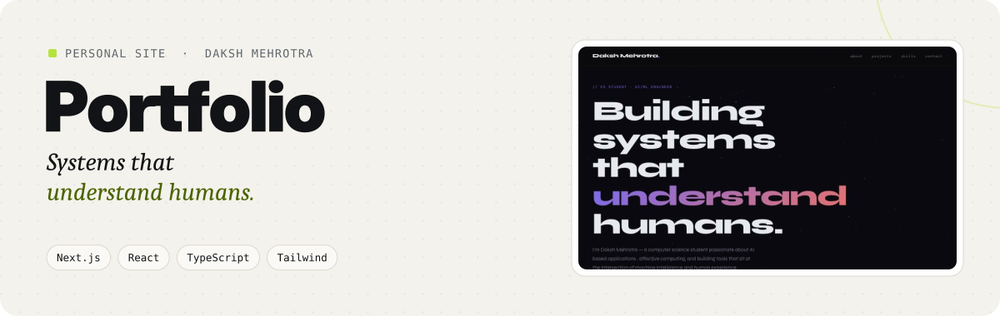

<picture>
  <source media="(prefers-color-scheme: dark)" srcset="assets/banner-dark.svg">
  
</picture>

<br>

The source for my personal site: a single page with who I am, what I've built, the tools I use and how to reach me. The live site is linked in this repo's About section.

## What's on it

- **About:** CS student and AI/ML engineer working on AI applications, affective computing, and tools at the meeting point of machine intelligence and human experience.
- **Projects:** a multimodal psychological screening system (audio emotion analysis, PHQ-9 and GAD-7 scoring, LLM-written reports) and a human–AI emotion interaction analyzer (RoBERTa + EfficientNet-B0, late fusion).
- **Skills** and **contact**.

## Built with

Next.js (App Router) · React · TypeScript · Tailwind CSS · deployed on Vercel

## Run it locally

```bash
npm install
npm run dev      # http://localhost:3000
```

The page lives in `app/page.tsx`; the project and skill lists are plain arrays at the top of that file, so adding a project means editing one object.
